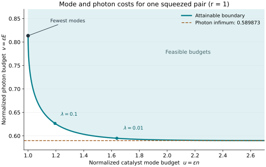

# Gaussian Entanglement Borrowing

How many optical modes and photons must a pure Gaussian catalyst contain to lend a fixed amount of entanglement while being returned almost unchanged?

This repository establishes a finite resource bound and the complete asymptotic tradeoff for this task. Both the catalyst mode count and its initial total photon inventory must diverge as the joint return error vanishes. Prepared ladders of two-mode squeezed states attain the sharp coefficients through passive local mode permutations.

## Question and main results

Alice and Bob begin with a known pure Gaussian catalyst and local vacuum target modes. They use local Gaussian processing to approximate the product of the **original catalyst and a prescribed pure Gaussian target**. The squared joint fidelity is at least $`1-\varepsilon`$; this single condition includes catalyst return, target preparation and decoupling.

Let $`n`$ count the catalyst's nonzero Gaussian Schmidt pairs, and let $`E`$ count its initial mean photons across both parties. The optimal constructions use exactly $`n`$ physical catalyst modes per party. For a fixed target with nonzero squeezings $`r_1,\ldots,r_k`$, define

```math
R=\sum_{j=1}^k r_j,\qquad
K=\sum_{j=1}^k(\cosh r_j-1),\qquad
H=\sum_{j=1}^k\int_0^{r_j}\sinh^2x\,dx.
```

| Result | Sharp small-error statement |
|---|---|
| Minimum catalyst modes, with unrestricted initial photons | $`\varepsilon n_{\min}\to R^2`$ |
| Infimum initial photons, with any finite catalyst mode count | $`\varepsilon E_{\rm opt}\to2K^2`$ |
| Optimal photon coefficient at the minimum mode coefficient | $`\varepsilon n\to R^2`$ requires $`\liminf\varepsilon E\ge2RH`$, attained by uniform ladders |
| Simultaneous finite normalized budgets | $`u\ge R^2`$ and $`v\ge V(u)`$, with the full boundary below |

The separate mode and photon optima use different families. At every finite normalized mode budget, the necessary photon coefficient is strictly above $`2K^2`$.

For $`\lambda\ge0`$, write

```math
A_\lambda=\sum_{j=1}^k\int_0^{r_j}
\sqrt{\sinh^2x+\lambda}\,dx,
\qquad
V(u)=2\sup_{\lambda\ge0}\{A_\lambda^2-\lambda u\}.
```

A finite budget pair $`(u,v)`$ is attainable when protocols exist for every sufficiently small requested $`\varepsilon`$ with fidelity at least $`1-\varepsilon`$ and
$`\limsup\varepsilon n\le u`$, $`\limsup\varepsilon E\le v`$.
The region $`u\ge R^2,\ v\ge V(u)`$ is exact in this asymptotic sense. The [model](science/model.md) states the finite inequality and all quantifiers; the [tradeoff proof](science/tradeoff.md) gives the boundary and its attaining families.

For one target pair of squeezing $`r`$, the individual coefficients are $`r^2`$ and $`2(\cosh r-1)^2`$. At $`r=1`$, the minimum-mode endpoint has normalized costs $`(1,0.813430)`$, while the photon infimum is $`0.589873`$ and requires an unbounded normalized mode count.



## Reading routes

| Reader's question | Start here |
|---|---|
| What is the scientific argument? | [Scientific overview](science/README.md) |
| What is allowed, charged and returned? | [Model and theorem statements](science/model.md) |
| Why can no allowed Gaussian protocol beat the bound? | [Gaussian geometry](science/gaussian_geometry.md), then [finite-resource converse](science/converse.md) |
| How are the optimal catalysts built? | [Passive constructions](science/constructions.md) |
| How do mode and photon budgets interact? | [Complete asymptotic tradeoff](science/tradeoff.md) |
| What does the result mean for optical resources? | [Physical interpretation and non-Gaussian comparisons](science/interpretation.md) |
| What is inherited from earlier work? | [Related work](references/related_work.md) and [bibliography](references/references.bib) |
| How can the calculations be reproduced? | [Verification guide](verification/README.md) |

The proof first controls entanglement-squeezing displacement by global fidelity. Componentwise Gaussian squeezing monotonicity then bounds every refined measurement branch, including branches contributing to rare success events. A weighted integral inequality gives the resource constraints. Cyclically shifting graded squeezing ladders saturates every asymptotic supporting bound.

## Scope

The catalyst is pure Gaussian and the target is a fixed finite pure Gaussian state. The operations are physical Gaussian LOCC instruments and the trace-norm closure of their normalized retained outputs for a fixed input and target. Local Gaussian ancillary resources, classical communication and positive-probability postselection are allowed.

The photon resource is the **initial catalyst inventory** at a common fixed oscillator frequency. It includes initial local squeezing and displacement. It does not charge catalyst preparation complexity or local control work. For canonical targets, the attaining permutations conserve actual photons exactly.

The account establishes a finite converse and a sharp asymptotic frontier. It does not establish the exact finite-error optimum, a mixed-catalyst theorem or a bound under arbitrary non-Gaussian processing. [Explicit non-Gaussian embeddings](science/interpretation.md#6-why-the-gaussian-model-matters) show why the Gaussian restrictions affect the resource laws.

## Reproduction

The checks use Python 3.12 with pinned numerical dependencies. From the repository root:

```bash
python -m pip install -r verification/requirements.txt
python verification/run_checks.py
python verification/plot_tradeoff.py
```

The suite challenges the geometric constants, finite resource inequalities, prescribed-error constructions and multimode tradeoff formulas. It writes the documented JSON records and finishes with `PASS: all finite scientific checks completed.` The figure is generated from the analytical boundary. Finite numerical checks support the implementations and normalizations; the proofs in `science/` establish the general results.

## Purpose and contact

This repository serves as a record of the work and a guide for the author’s self-directed learning. For discussion or potential collaboration, please contact Ruge Lin at [gogoko699@gmail.com](mailto:gogoko699@gmail.com).

## License

[MIT License](LICENSE).

