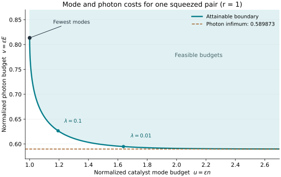

# Physical interpretation and examples

The [resource theorem](model.md) identifies two independent requirements for accurate Gaussian entanglement borrowing. The catalyst must contain enough entangled modes, and its total initial photon inventory must also grow. These requirements persist under measurements, classical communication, active local Gaussian controls and postselection.

## 1. More photons cannot replace enough modes

For a single target squeezing $`r>0`$, the finite converse gives

```math
q_\varepsilon(n+1)\ge r^2,
\qquad
q_\varepsilon=
\frac12\mathrm{arcosh}^2\!\left(\frac1{1-\varepsilon}\right).
```

Thus a fixed number of entangled catalyst mode pairs imposes a nonzero error floor, regardless of their brightness. Every oscillator already has infinite Hilbert dimension. The obstruction comes from the ordered Gaussian squeezing spectrum: Gaussian local processing cannot turn a finite list into a slightly shifted list that includes an additional fixed nonzero entry at arbitrarily small global fidelity cost.

A physical catalyst can contain additional locally unentangled modes. Those modes add zeros to its squeezing spectrum and do not remove this obstruction. The optimal construction uses every catalyst mode as one member of a shared squeezed pair.

## 2. More weak pairs cannot keep total photons bounded

The same converse, with a different weight, gives

```math
q_\varepsilon
\left[\frac E2+\sinh^2r\right]
\ge(\cosh r-1)^2.
```

Hence bounded initial photons impose an error floor even when arbitrarily many catalyst modes are available. Distributing entanglement over more weak pairs can improve the energy coefficient, but its total inventory still grows as $`1/\varepsilon`$.

For the fixed target list $`\mathbf r`$, the energy coefficient is $`2K^2`$, where $`K=\sum_j(\cosh r_j-1)`$. Approaching this coefficient requires $`\varepsilon n\to\infty`$. The explicit energy construction uses $`n=O(\varepsilon^{-1}\log(1/\varepsilon))`$; the logarithmic overhead is a sufficient construction rate, not a lower bound on the required overhead.

## 3. A concrete tradeoff

For one target with $`r=1`$, the [asymptotic boundary](tradeoff.md) has the following coefficients. The photon column counts both parties.

| Catalyst family | $`u=\lim\varepsilon n`$ | $`v=\lim\varepsilon E`$ |
|---|---:|---:|
| Minimum modes | 1.000000 | 0.813430 |
| Graded ladder, $`\lambda=1`$ | 1.017453 | 0.727289 |
| Graded ladder, $`\lambda=0.1`$ | 1.193468 | 0.626523 |
| Graded ladder, $`\lambda=0.01`$ | 1.638298 | 0.594851 |
| Photon infimum | Unbounded | 0.589873 |



The shaded region contains achievable asymptotic budgets. At the left endpoint, the fewest modes require a larger photon coefficient. Moving to the right reduces that coefficient toward its infimum. These numbers are limiting coefficients, not exact finite-error resource caps. The finite statements retain $`q_\varepsilon`$, the target-energy term and the mode correction.

The [plot generator](../verification/plot_tradeoff.py) evaluates the analytical integrals; [its data](../verification/tradeoff_curve.json) record the plotted points. This figure is not a fit to a simulation.

## 4. Passive extraction and approximate return

Consider a catalyst

```math
|C\rangle=|x_1\rangle\otimes\cdots\otimes|x_n\rangle,
\qquad
r=x_0\ge x_1\ge\cdots\ge x_n\ge x_{n+1}=0.
```

A cyclic permutation at each party produces

```math
|x_1\rangle_T\otimes
|x_2\rangle_{C_1}\otimes\cdots\otimes
|x_n\rangle_{C_{n-1}}\otimes|0\rangle_{C_n}.
```

The actual target and catalyst remain a product. The catalyst is slightly depleted, and the target is slightly less squeezed than $`r`$. The joint squared overlap with $`|r\rangle_T\otimes|C\rangle`$ is

```math
F=\prod_{i=0}^{n}\mathrm{sech}^2(x_i-x_{i+1}).
```

For small gaps, infidelity accumulates quadratically in their sizes. This permits a fixed total shift from $`r`$ to zero to be distributed over many modes.

Both local permutations preserve the actual total photon number. As the gaps vanish, the target receives approximately $`2\sinh^2r`$ photons and the catalyst loses the same amount. Its initial energy diverges, so fidelity closeness does not force that finite energy difference to vanish. Photon number is an unbounded observable; state closeness alone does not give a uniform bound on its expectation difference over this family.

Every pair in the attaining catalysts has squeezing at most the largest fixed target squeezing. No individual mode needs diverging squeezing. The divergent inventory is spread over a growing number of prepared pairs. Preparation precision and control work are separate resources from the inventory optimized here.

## 5. Several borrowed pairs

For $`k`$ identical target pairs of squeezing $`r`$, the finite inequalities are

```math
n\ge\frac{k^2r^2}{q_\varepsilon}-k,
\qquad
E\ge
\frac{2k^2(\cosh r-1)^2}{q_\varepsilon}
-2k\sinh^2r.
```

The quadratic leading dependence reflects the joint accuracy requirement. Splitting a fixed global error budget among several outputs requires a finer collection of catalyst ladders. The attaining construction uses a common ladder step across all targets, and the total fidelity is the product of all pair overlaps. The asymptotic theorem fixes $`k`$; the displayed finite bounds themselves hold for every finite $`k`$.

## 6. Why the Gaussian model matters

The two resource divergences do not hold for all pure catalysts and arbitrary local unitaries. Two embeddings of the established [van Dam–Hayden embezzling family](https://arxiv.org/pdf/quant-ph/0201041) give useful comparisons. Both the catalyst and the local controls in these examples are generally non-Gaussian.

Let

```math
|\mu_d\rangle=\frac1{\sqrt{h_d}}
\sum_{j=1}^{d}\frac{|j\rangle_A|j\rangle_B}{\sqrt j},
\qquad h_d=\sum_{j=1}^{d}\frac1j.
```

For a target of Schmidt rank $`m`$, their local rearrangement gives root overlap at least $`1-\log(m)/\log(d)`$ with the original catalyst tensor the target. This statement concerns a finite-dimensional logical state; its optical embedding determines the charged physical resources.

For a fixed TMSV, put $`q=\tanh r`$ and truncate its Fock expansion at $`m`$ terms, renormalizing to $`|r_m\rangle`$. Its purified distance from $`|r\rangle`$ is exactly $`q^m`$. Choose

```math
m=\max\left\{2,
\left\lceil\frac{\log(2/\sqrt\varepsilon)}{-\log q}\right\rceil
\right\},
\qquad
d=\left\lceil m^{8/\varepsilon}\right\rceil.
```

The target truncation contributes purified distance at most $`\sqrt\varepsilon/2`$. The embezzling step contributes at most

```math
\sqrt{\frac{2\log m}{\log d}}
\le\frac{\sqrt\varepsilon}{2}.
```

The triangle inequality therefore gives joint squared fidelity at least $`1-\varepsilon`$ with $`|\mu_d\rangle\otimes|r\rangle`$.

**One catalyst oscillator per party.** Encode logical $`|j\rangle`$ as Fock $`|j-1\rangle`$. Then

```math
E=\frac2{h_d}\sum_{j=1}^{d}\frac{j-1}{j}
=\frac{2(d-h_d)}{h_d}\lt \infty.
```

The local operation acts on the finite catalyst-by-target subspace of dimension $`dm`$ and extends by the identity to a unitary on the full oscillator Hilbert space. One catalyst oscillator per party suffices for every accuracy, with rapidly growing photon inventory.

**Two total catalyst photons.** Instead encode logical $`|j\rangle`$ as one photon in mode $`j`$ among $`d`$ catalyst modes at each party. The catalyst then has exactly one photon per party, hence $`E=2`$, for every accuracy. The embezzling unitary acts inside the catalyst's one-photon sector tensored with the truncated target space. Target energy can be supplied by the unrestricted local controls.

These are separate existence comparisons. The first keeps modes fixed and allows photons to grow; the second keeps photons fixed and allows modes to grow. They do not establish simultaneous bounded resources, practical preparation, or efficient control. They show why a theorem stated for pure Gaussian catalysts and Gaussian controls is a physical restriction, rather than a universal thermodynamic inventory law.

## 7. Accuracy and implementation boundaries

Replacing infidelity by a purified-distance tolerance $`\delta`$ is exact: set $`\varepsilon=\delta^2`$, so both individual costs grow as $`1/\delta^2`$. A trace-distance specification for arbitrary mixed outputs is a different optimization and is not obtained by renaming the parameter.

The construction gives an ideal optical resource state and a passive extraction operation. It does not price preparation, calibration, loss correction, a spatial architecture, or gate time. Mixed Gaussian catalysts also remain outside the converse: a purification can carry additional shared entanglement and energy. These boundaries identify which physical resources the stated tradeoff measures.
